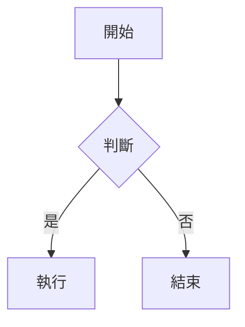
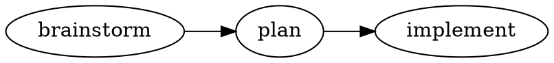

# Pretty MD Reader Implementation Plan

> **For agentic workers:** REQUIRED SUB-SKILL: Use superpowers:subagent-driven-development (recommended) or superpowers:executing-plans to implement this plan task-by-task. Steps use checkbox (`- [ ]`) syntax for tracking.

**Goal:** Build a VS Code extension that makes the built-in Markdown preview read beautifully (Obsidian-style, light only) for AI-generated plans/specs and READMEs.

**Architecture:** Extend the built-in Markdown preview via VS Code's `contributes.markdown.*` points — inject a CSS theme, a bundled webview script, and markdown-it plugins. No custom webview. Callouts come from `markdown-it-github-alerts`; a small custom markdown-it fence plugin tags `mermaid`/`dot`/`graphviz` code blocks; the webview script renders them client-side with `mermaid` and `@hpcc-js/wasm-graphviz`.

**Tech Stack:** TypeScript, esbuild (two bundles: Node CJS extension + browser IIFE webview script), Vitest (unit tests), markdown-it, markdown-it-github-alerts, mermaid, @hpcc-js/wasm-graphviz, vsce (packaging).

## Global Constraints

- `engines.vscode`: `^1.85.0` (set verbatim in package.json).
- Appearance: **light mode only**. Do not add theme switching or dark CSS.
- Fonts: **cross-platform fallback stacks only** — never depend on a single OS font. Latin: `Inter, -apple-system, "Segoe UI", Roboto, sans-serif`. CJK: `"PingFang TC", "Microsoft JhengHei", "Noto Sans CJK TC", sans-serif`. Mono: `"JetBrains Mono", "SF Mono", Consolas, monospace`.
- Runtime must work **offline**: bundle all webview deps into `media/diagram-init.js`; no CDN/network fetches at preview time.
- `publisher`: `bolaslien` (must match the Marketplace publisher the user creates before publishing).
- Out of scope (do not build): settings UI, export, KaTeX/math, dark mode, custom webview.

---

## File Structure

- `package.json` — extension manifest, contributes points, Marketplace metadata, scripts.
- `tsconfig.json` — TypeScript config.
- `build.mjs` — esbuild build (extension + webview bundles).
- `vitest.config.ts` — test config.
- `src/extension.ts` — activation entry; registers markdown-it plugins via `extendMarkdownIt`.
- `src/markdown-it/diagrams.ts` — fence override tagging mermaid/dot/graphviz blocks.
- `src/webview/diagram-init.ts` — client-side renderer (mermaid + graphviz), bundled to `media/diagram-init.js`.
- `media/preview.css` — the Obsidian-style light theme (the visual core).
- `test/diagrams.test.ts` — unit tests for the fence plugin.
- `samples/sample.md` — manual visual-acceptance fixture.
- `icon.png`, `README.md`, `CHANGELOG.md`, `LICENSE`, `.vscodeignore` — Marketplace assets.

---

### Task 1: Project scaffold and build pipeline

**Files:**
- Create: `package.json`, `tsconfig.json`, `build.mjs`, `vitest.config.ts`, `.gitignore` (already exists — verify), `.vscodeignore`

**Interfaces:**
- Consumes: nothing.
- Produces: `npm run build` emits `out/extension.js` (Node CJS) and `media/diagram-init.js` (browser IIFE); `npm test` runs Vitest. These scripts are used by every later task.

- [ ] **Step 1: Create `package.json`**

```json
{
  "name": "pretty-md-reader",
  "displayName": "Pretty MD Reader",
  "description": "Obsidian-style pretty rendering for the built-in Markdown preview, with callouts, Mermaid and Graphviz diagrams.",
  "version": "0.0.1",
  "publisher": "bolaslien",
  "license": "MIT",
  "engines": { "vscode": "^1.85.0" },
  "categories": ["Other"],
  "keywords": ["markdown", "preview", "mermaid", "graphviz", "callouts"],
  "main": "./out/extension.js",
  "contributes": {
    "markdown.previewStyles": ["./media/preview.css"],
    "markdown.previewScripts": ["./media/diagram-init.js"],
    "markdown.markdownItPlugins": true
  },
  "scripts": {
    "build": "node build.mjs",
    "watch": "node build.mjs --watch",
    "test": "vitest run",
    "package": "vsce package"
  },
  "devDependencies": {
    "@hpcc-js/wasm-graphviz": "^1.7.0",
    "@types/markdown-it": "^14.1.2",
    "@types/node": "^20.11.0",
    "@types/vscode": "^1.85.0",
    "esbuild": "^0.21.0",
    "markdown-it": "^14.1.0",
    "markdown-it-github-alerts": "^0.3.0",
    "mermaid": "^11.0.0",
    "typescript": "^5.4.0",
    "vitest": "^1.6.0"
  }
}
```

- [ ] **Step 2: Create `tsconfig.json`**

```json
{
  "compilerOptions": {
    "module": "ESNext",
    "moduleResolution": "Bundler",
    "target": "ES2020",
    "lib": ["ES2020", "DOM"],
    "strict": true,
    "esModuleInterop": true,
    "skipLibCheck": true,
    "resolveJsonModule": true,
    "noEmit": true
  },
  "include": ["src", "test"]
}
```

- [ ] **Step 3: Create `build.mjs`**

```js
import * as esbuild from 'esbuild'

const watch = process.argv.includes('--watch')

const builds = [
  {
    entryPoints: ['src/extension.ts'],
    bundle: true,
    platform: 'node',
    format: 'cjs',
    target: 'node18',
    external: ['vscode'],
    outfile: 'out/extension.js',
  },
  {
    entryPoints: ['src/webview/diagram-init.ts'],
    bundle: true,
    platform: 'browser',
    format: 'iife',
    target: 'es2020',
    outfile: 'media/diagram-init.js',
  },
]

if (watch) {
  for (const b of builds) (await esbuild.context(b)).watch()
  console.log('watching...')
} else {
  await Promise.all(builds.map((b) => esbuild.build(b)))
  console.log('build complete')
}
```

- [ ] **Step 4: Create `vitest.config.ts`**

```ts
import { defineConfig } from 'vitest/config'

export default defineConfig({
  test: { include: ['test/**/*.test.ts'] },
})
```

- [ ] **Step 5: Create `.vscodeignore`**

```
.vscode/**
src/**
test/**
samples/**
docs/**
.superpowers/**
node_modules/**
build.mjs
tsconfig.json
vitest.config.ts
**/*.map
```

- [ ] **Step 6: Install dependencies and verify build tooling**

Run: `npm install`
Expected: completes without errors; `node_modules/` populated.

- [ ] **Step 7: Commit**

```bash
git add package.json package-lock.json tsconfig.json build.mjs vitest.config.ts .vscodeignore
git commit -m "chore: scaffold extension build pipeline"
```

---

### Task 2: Diagram fence markdown-it plugin

**Files:**
- Create: `src/markdown-it/diagrams.ts`
- Test: `test/diagrams.test.ts`

**Interfaces:**
- Consumes: `markdown-it` (`MarkdownIt` type and instance).
- Produces: `export function diagramsPlugin(md: MarkdownIt): void`. After `md.use(diagramsPlugin)`, a fenced block with info string `mermaid` renders as `<pre class="mermaid">…</pre>`, and `dot` or `graphviz` render as `<pre class="graphviz">…</pre>`. All other fences fall through to markdown-it's default fence renderer. Content is HTML-escaped.

- [ ] **Step 1: Write the failing test**

Create `test/diagrams.test.ts`:

```ts
import { describe, it, expect } from 'vitest'
import MarkdownIt from 'markdown-it'
import { diagramsPlugin } from '../src/markdown-it/diagrams'

const md = new MarkdownIt().use(diagramsPlugin)

describe('diagramsPlugin', () => {
  it('renders mermaid fence as pre.mermaid', () => {
    const out = md.render('```mermaid\ngraph TD; A-->B;\n```')
    expect(out).toContain('<pre class="mermaid">')
    expect(out).toContain('graph TD; A--&gt;B;')
  })

  it('renders dot fence as pre.graphviz', () => {
    const out = md.render('```dot\ndigraph { a -> b }\n```')
    expect(out).toContain('<pre class="graphviz">')
  })

  it('renders graphviz fence as pre.graphviz', () => {
    const out = md.render('```graphviz\ndigraph { a -> b }\n```')
    expect(out).toContain('<pre class="graphviz">')
  })

  it('leaves other languages to the default fence renderer', () => {
    const out = md.render('```js\nconst x = 1\n```')
    expect(out).not.toContain('class="mermaid"')
    expect(out).not.toContain('class="graphviz"')
    expect(out).toContain('<code')
  })

  it('escapes HTML in diagram content', () => {
    const out = md.render('```mermaid\n<script>alert(1)</script>\n```')
    expect(out).toContain('&lt;script&gt;')
    expect(out).not.toContain('<script>alert(1)</script>')
  })
})
```

- [ ] **Step 2: Run test to verify it fails**

Run: `npm test`
Expected: FAIL — cannot resolve `../src/markdown-it/diagrams`.

- [ ] **Step 3: Write minimal implementation**

Create `src/markdown-it/diagrams.ts`:

```ts
import type MarkdownIt from 'markdown-it'

const DIAGRAM_LANGS: Record<string, string> = {
  mermaid: 'mermaid',
  dot: 'graphviz',
  graphviz: 'graphviz',
}

export function diagramsPlugin(md: MarkdownIt): void {
  const defaultFence = md.renderer.rules.fence!.bind(md.renderer.rules)

  md.renderer.rules.fence = (tokens, idx, options, env, self) => {
    const token = tokens[idx]
    const info = token.info.trim().split(/\s+/)[0].toLowerCase()
    const kind = DIAGRAM_LANGS[info]
    if (!kind) return defaultFence(tokens, idx, options, env, self)
    return `<pre class="${kind}">${md.utils.escapeHtml(token.content)}</pre>\n`
  }
}
```

- [ ] **Step 4: Run test to verify it passes**

Run: `npm test`
Expected: PASS (5 tests).

- [ ] **Step 5: Commit**

```bash
git add src/markdown-it/diagrams.ts test/diagrams.test.ts
git commit -m "feat: add diagram fence markdown-it plugin"
```

---

### Task 3: Extension entry — register markdown-it plugins

**Files:**
- Create: `src/extension.ts`

**Interfaces:**
- Consumes: `diagramsPlugin` from Task 2; `markdown-it-github-alerts` default export.
- Produces: `export function activate()` returning `{ extendMarkdownIt(md): MarkdownIt }` that chains `markdown-it-github-alerts` (with `matchCaseSensitive: false` for Obsidian lowercase callouts) and `diagramsPlugin`. `export function deactivate(): void`.

- [ ] **Step 1: Write `src/extension.ts`**

```ts
import type MarkdownIt from 'markdown-it'
import githubAlerts from 'markdown-it-github-alerts'
import { diagramsPlugin } from './markdown-it/diagrams'

export function activate() {
  return {
    extendMarkdownIt(md: MarkdownIt) {
      return md.use(githubAlerts, { matchCaseSensitive: false }).use(diagramsPlugin)
    },
  }
}

export function deactivate(): void {}
```

- [ ] **Step 2: Build to verify it compiles and bundles**

Run: `npm run build`
Expected: `build complete`; `out/extension.js` exists.

Verify: `node -e "require('./out/extension.js').activate()"`
Expected: no throw (returns the extend object).

- [ ] **Step 3: Commit**

```bash
git add src/extension.ts
git commit -m "feat: register github-alerts and diagram plugins on preview"
```

---

### Task 4: Webview diagram renderer

**Files:**
- Create: `src/webview/diagram-init.ts` (bundled to `media/diagram-init.js`)

**Interfaces:**
- Consumes: `mermaid`, `@hpcc-js/wasm-graphviz` (`Graphviz`); the DOM elements `pre.mermaid` and `pre.graphviz` produced by Task 2.
- Produces: a self-running browser script that renders each diagram element in place and re-renders when the preview DOM updates (live edits). On failure it falls back to showing the raw source. No exports (IIFE side-effect bundle).

- [ ] **Step 1: Write `src/webview/diagram-init.ts`**

```ts
import mermaid from 'mermaid'
import { Graphviz } from '@hpcc-js/wasm-graphviz'

mermaid.initialize({ startOnLoad: false, theme: 'default', securityLevel: 'loose' })

let graphvizPromise: Promise<Graphviz> | null = null
const getGraphviz = () => (graphvizPromise ??= Graphviz.load())

function showError(el: HTMLElement, src: string): void {
  el.innerHTML = ''
  const pre = document.createElement('pre')
  pre.className = 'diagram-error'
  pre.textContent = src
  el.appendChild(pre)
}

async function renderMermaid(el: HTMLElement): Promise<void> {
  if (el.dataset.rendered) return
  el.dataset.rendered = '1'
  const src = el.textContent ?? ''
  try {
    const id = 'm' + Math.random().toString(36).slice(2)
    const { svg } = await mermaid.render(id, src)
    el.innerHTML = svg
    el.classList.add('diagram-rendered')
  } catch {
    el.dataset.rendered = ''
    showError(el, src)
  }
}

async function renderGraphviz(el: HTMLElement): Promise<void> {
  if (el.dataset.rendered) return
  el.dataset.rendered = '1'
  const src = el.textContent ?? ''
  try {
    const gv = await getGraphviz()
    el.innerHTML = gv.dot(src)
    el.classList.add('diagram-rendered')
  } catch {
    el.dataset.rendered = ''
    showError(el, src)
  }
}

function renderAll(): void {
  document
    .querySelectorAll<HTMLElement>('pre.mermaid:not(.diagram-rendered)')
    .forEach((el) => void renderMermaid(el))
  document
    .querySelectorAll<HTMLElement>('pre.graphviz:not(.diagram-rendered)')
    .forEach((el) => void renderGraphviz(el))
}

const observer = new MutationObserver(() => renderAll())
observer.observe(document.body, { childList: true, subtree: true })
renderAll()
```

- [ ] **Step 2: Build to verify the browser bundle is produced**

Run: `npm run build`
Expected: `build complete`; `media/diagram-init.js` exists and is non-empty (bundles mermaid + graphviz wasm inline).

Verify: `node -e "const s=require('fs').statSync('media/diagram-init.js'); if(s.size<10000) throw new Error('bundle too small')"`
Expected: no throw.

- [ ] **Step 3: Commit**

```bash
git add src/webview/diagram-init.ts media/diagram-init.js
git commit -m "feat: render mermaid and graphviz diagrams in preview"
```

---

### Task 5: Obsidian-style light theme + visual acceptance

**Files:**
- Create: `media/preview.css`, `samples/sample.md`

**Interfaces:**
- Consumes: the built-in preview HTML structure; `.markdown-alert*` classes from `markdown-it-github-alerts`; `.diagram-error` from Task 4.
- Produces: the visual theme. No code interface; validated by manual visual acceptance against `samples/sample.md`.

- [ ] **Step 1: Write `media/preview.css`**

```css
:root {
  --pmr-accent: #5a3ec8;
  --pmr-accent-soft: #7c5cde;
  --pmr-accent-bg: #efeaff;
  --pmr-text: #2e3338;
  --pmr-muted: #8a8f98;
  --pmr-border: #e7e3f5;
  --pmr-code-bg: #1f2430;
  --pmr-code-fg: #d8dee9;
}

body.vscode-body {
  font-family: Inter, -apple-system, "Segoe UI", Roboto, "PingFang TC",
    "Microsoft JhengHei", "Noto Sans CJK TC", sans-serif;
  color: var(--pmr-text);
  line-height: 1.75;
  font-size: 15.5px;
  max-width: 860px;
  margin: 0 auto;
  padding: 32px 28px 80px;
  background: #ffffff;
}

h1, h2, h3, h4 { font-weight: 700; letter-spacing: -0.01em; line-height: 1.3; }
h1 { color: var(--pmr-accent); font-size: 30px; margin: 0 0 16px; }
h2 { color: var(--pmr-accent); font-size: 24px; margin: 32px 0 12px; }
h3 { color: var(--pmr-accent-soft); font-size: 19px; margin: 26px 0 8px; }
p { margin: 0 0 14px; }

a { color: var(--pmr-accent-soft); text-decoration: none; }
a:hover { text-decoration: underline; }

code {
  font-family: "JetBrains Mono", "SF Mono", Consolas, monospace;
  background: var(--pmr-accent-bg);
  color: #6d4ee0;
  padding: 2px 6px;
  border-radius: 5px;
  font-size: 0.88em;
}

pre {
  background: var(--pmr-code-bg);
  border-radius: 10px;
  padding: 16px 18px;
  overflow: auto;
  line-height: 1.6;
}
pre code {
  background: none;
  color: var(--pmr-code-fg);
  padding: 0;
  font-size: 13px;
}

blockquote {
  border-left: 4px solid var(--pmr-border);
  margin: 0 0 16px;
  padding: 2px 16px;
  color: var(--pmr-muted);
}

table {
  border-collapse: separate;
  border-spacing: 0;
  width: 100%;
  margin: 0 0 16px;
  border-radius: 8px;
  overflow: hidden;
  font-size: 14px;
}
th, td { text-align: left; padding: 9px 13px; }
th { background: var(--pmr-accent-bg); color: var(--pmr-accent); font-weight: 600; }
tr:nth-child(even) td { background: #faf9ff; }

ul, ol { padding-left: 1.4em; margin: 0 0 14px; }
li { margin: 4px 0; }

/* task lists */
li.task-list-item { list-style: none; }
li.task-list-item input[type="checkbox"] {
  appearance: none;
  width: 16px; height: 16px;
  border: 1.5px solid var(--pmr-accent-soft);
  border-radius: 5px;
  margin: 0 8px 0 -1.6em;
  vertical-align: -2px;
  position: relative;
}
li.task-list-item input[type="checkbox"]:checked {
  background: var(--pmr-accent);
  border-color: var(--pmr-accent);
}
li.task-list-item input[type="checkbox"]:checked::after {
  content: "✓";
  color: #fff;
  font-size: 11px;
  position: absolute;
  left: 2px; top: -2px;
}

/* github-alerts callouts */
.markdown-alert {
  background: var(--pmr-accent-bg);
  border-left: 4px solid var(--pmr-accent-soft);
  border-radius: 8px;
  padding: 12px 16px;
  margin: 0 0 16px;
}
.markdown-alert > :last-child { margin-bottom: 0; }
.markdown-alert-title {
  display: flex;
  align-items: center;
  gap: 6px;
  font-weight: 650;
  font-size: 13px;
  margin-bottom: 4px;
  color: var(--pmr-accent);
}
.markdown-alert-title svg { fill: currentColor; }
.markdown-alert-note    { border-left-color: #4c8dff; }
.markdown-alert-note    .markdown-alert-title { color: #2f6fe0; }
.markdown-alert-tip     { border-left-color: #2ecc71; }
.markdown-alert-tip     .markdown-alert-title { color: #1e9e57; }
.markdown-alert-important { border-left-color: var(--pmr-accent-soft); }
.markdown-alert-warning { border-left-color: #f0a020; }
.markdown-alert-warning .markdown-alert-title { color: #c47e10; }
.markdown-alert-caution { border-left-color: #ef4444; }
.markdown-alert-caution .markdown-alert-title { color: #d12f2f; }

/* diagrams */
pre.mermaid, pre.graphviz {
  background: #ffffff;
  border: 1px solid var(--pmr-border);
  border-radius: 10px;
  text-align: center;
  padding: 18px;
}
pre.mermaid svg, pre.graphviz svg { max-width: 100%; height: auto; }
.diagram-error {
  background: var(--pmr-code-bg);
  color: var(--pmr-code-fg);
  text-align: left;
}

img { max-width: 100%; border-radius: 8px; }
hr { border: none; border-top: 1px solid var(--pmr-border); margin: 28px 0; }
```

- [ ] **Step 2: Create `samples/sample.md`** (covers every styled element)

````markdown
# 專案週報

2026 年第 25 週的閱讀測試文件，涵蓋各種 Markdown 元素。

## 中文長段落

這是一段較長的中文內文，用來確認字體 fallback、行距與字級在長時間閱讀下是否舒適。預覽應該呈現 Obsidian 風的淺色外觀，標題帶紫色強調。

## 任務清單

- [x] 完成排版樣式
- [ ] 完成 Mermaid 渲染
- [ ] 完成 Graphviz 渲染
  - [ ] 巢狀子項目

## 表格

| 項目 | 狀態 | 負責 |
| --- | --- | --- |
| 排版樣式 | 進行中 | 我 |
| 圖表渲染 | 待開始 | 我 |

## 程式碼

行內 `markdown-it` 與區塊：

```ts
export function activate() {
  return { extendMarkdownIt: (md) => md }
}
```

## Callouts

> [!NOTE]
> 這是一個 note callout。

> [!tip]
> 小寫的 Obsidian 風 callout 也要能解析。

> [!WARNING]
> 警告色塊。

## Mermaid 圖



## Graphviz 圖


````

- [ ] **Step 3: Manual visual acceptance**

Run: `npm run build`, then press F5 in VS Code (Extension Development Host), open `samples/sample.md`, and open the preview (`Cmd+Shift+V`).

Verify against the spec's acceptance criteria:
- Obsidian-style light look: purple headings, Inter/CJK fonts, dark code blocks, purple-tinted tables.
- Task list checkboxes render as rounded boxes (checked one filled).
- All three callouts render as colored blocks; lowercase `[!tip]` works.
- Mermaid flowchart renders as SVG.
- Graphviz `dot` graph renders as SVG.
- Chinese paragraph reads comfortably.

If any item fails, adjust `media/preview.css` (or the relevant earlier task) and re-verify before committing.

- [ ] **Step 4: Commit**

```bash
git add media/preview.css samples/sample.md
git commit -m "feat: add Obsidian-style light theme and sample fixture"
```

---

### Task 6: Marketplace packaging assets

**Files:**
- Create: `README.md`, `CHANGELOG.md`, `LICENSE`, `icon.png`

**Interfaces:**
- Consumes: the built extension from Tasks 1–5.
- Produces: a publishable package; `npx vsce package` succeeds and emits `pretty-md-reader-0.0.1.vsix`.

- [ ] **Step 1: Add `icon.png`**

Add a 128×128 PNG named `icon.png` at the repo root (extension icon). Then add to `package.json` top level: `"icon": "icon.png"`.

- [ ] **Step 2: Write `README.md`**

Include: extension name, what it does (Obsidian-style pretty Markdown preview with callouts, Mermaid, Graphviz), a feature list, a "how to use" line (open any Markdown file and use the built-in preview), and at least one screenshot of `samples/sample.md` rendered. Save the screenshot under `images/` and reference it.

- [ ] **Step 3: Write `CHANGELOG.md`**

```markdown
# Change Log

## 0.0.1
- Initial release: Obsidian-style light theme for the built-in Markdown preview.
- GitHub/Obsidian callouts, Mermaid and Graphviz diagram rendering, styled task lists and tables.
```

- [ ] **Step 4: Add `LICENSE`** (MIT, matching `package.json` `license` field).

- [ ] **Step 5: Package to verify**

Run: `npx vsce package`
Expected: produces `pretty-md-reader-0.0.1.vsix` with no fatal errors (warnings about repository field are acceptable; add `"repository"` to `package.json` to clear them).

- [ ] **Step 6: Commit**

```bash
git add README.md CHANGELOG.md LICENSE icon.png package.json images
git commit -m "docs: add Marketplace packaging assets"
```

---

## Self-Review

**Spec coverage:**
- Extend built-in preview (route 1) → Tasks 1, 3 (contributes points + extendMarkdownIt). ✓
- Obsidian-style, light only → Task 5 CSS; Global Constraints. ✓
- Cross-platform fonts → Global Constraints + Task 5 font stacks. ✓
- Code blocks / inline code styling → Task 5. ✓
- Tables (purple header, zebra, rounded) → Task 5. ✓
- Task-list checkboxes → Task 5 + sample. ✓
- Callouts (5 types + Obsidian lowercase) → Task 3 (`markdown-it-github-alerts`, `matchCaseSensitive:false`) + Task 5 styling. ✓
- Mermaid → Tasks 2, 4. ✓
- Graphviz dot → Tasks 2, 4. ✓
- Graceful diagram failure → Task 4 `showError`. ✓
- TypeScript + esbuild → Task 1. ✓
- Unit tests for fence plugin → Task 2. ✓
- Manual visual acceptance via sample → Task 5. ✓
- Marketplace assets (icon/README/CHANGELOG/LICENSE/.vscodeignore/vsce/semver) → Tasks 1 + 6. ✓
- Out of scope items excluded → confirmed; no settings/export/math/dark/webview tasks. ✓

**Placeholder scan:** No TBD/TODO; every code step has complete code. `icon.png` and the README screenshot are genuine binary artifacts described concretely (size, name, location), not code placeholders.

**Type consistency:** `diagramsPlugin(md: MarkdownIt): void` is defined in Task 2 and consumed identically in Task 3. Class names `pre.mermaid` / `pre.graphviz` produced in Task 2 match the selectors in Task 4 and Task 5. `.diagram-error` produced in Task 4 matches Task 5 styling. `.markdown-alert*` classes match the documented output of `markdown-it-github-alerts`.
