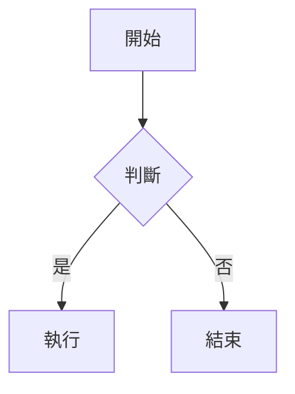

# 專案週報

2026 年第 25 週的閱讀測試文件，涵蓋各種 Markdown 元素。

## 中文長段落

這是一段較長的中文內文，用來確認字體 fallback、行距與字級在長時間閱讀下是否舒適。預覽應該呈現 Obsidian 風的淺色外觀，標題帶紫色強調。

## 任務清單

- [x] 完成排版樣式
- [ ] 完成 Mermaid 渲染
- [ ] 完成 Graphviz 渲染
  - [ ] 巢狀子項目

## 表格

| 項目 | 狀態 | 負責 |
| --- | --- | --- |
| 排版樣式 | 進行中 | 我 |
| 圖表渲染 | 待開始 | 我 |

## 程式碼

行內 `markdown-it` 與區塊：

```ts
export function activate() {
  return { extendMarkdownIt: (md) => md }
}
```

## Callouts

> [!NOTE]
> 這是一個 note callout。

> [!tip]
> 小寫的 Obsidian 風 callout 也要能解析。

> [!WARNING]
> 警告色塊。

## Mermaid 圖



## Graphviz 圖


